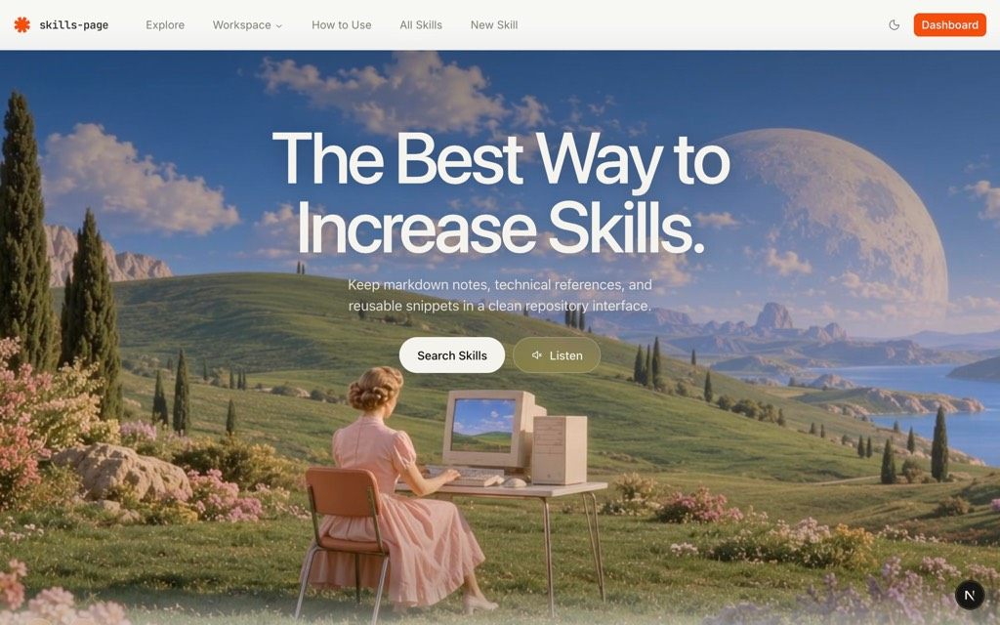
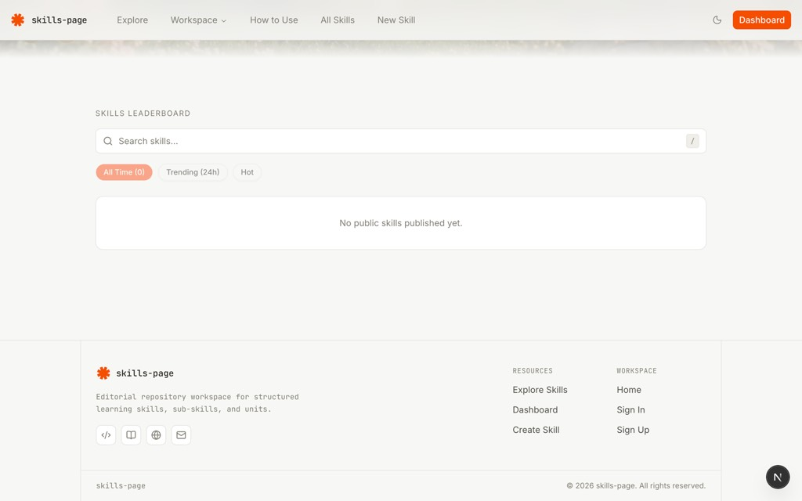
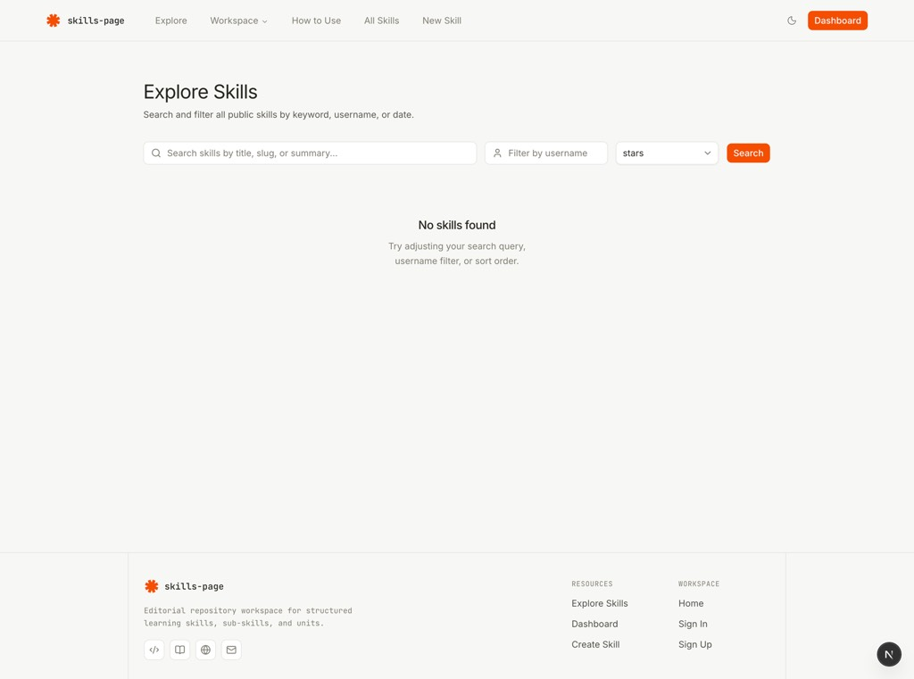
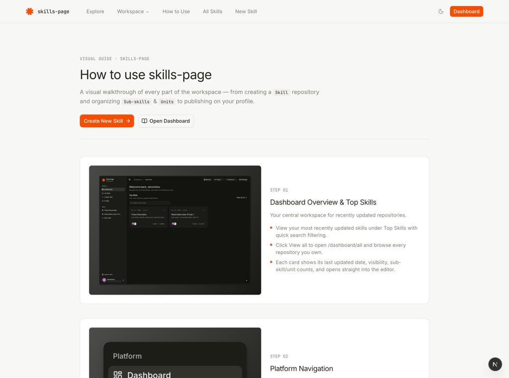
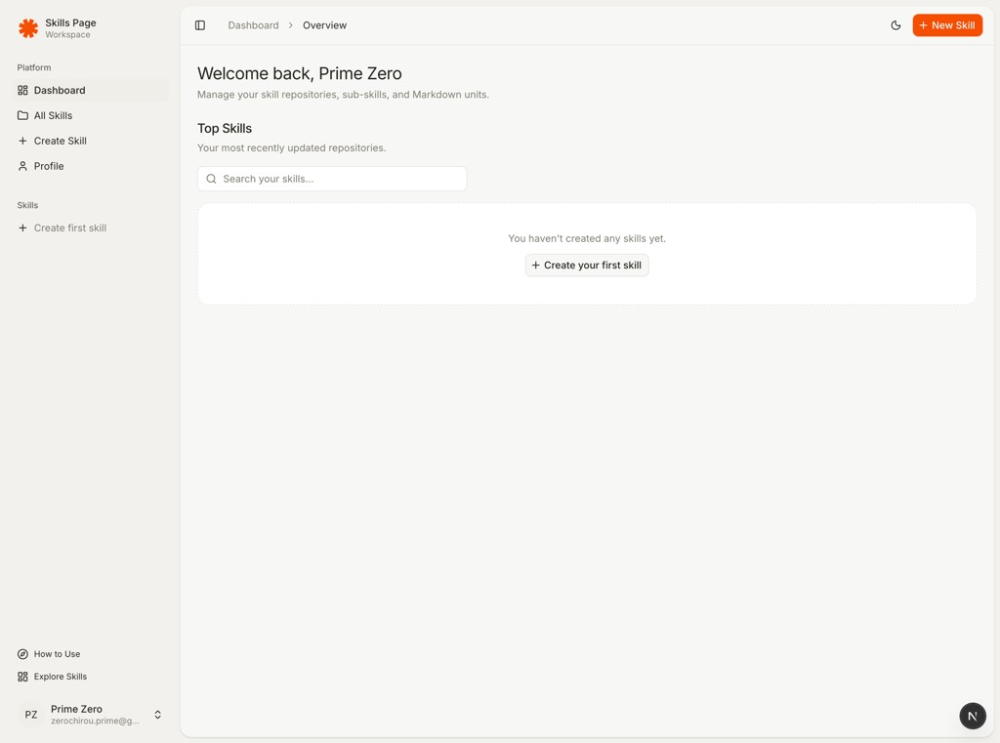

# skills-page

An editorial repository workspace for structured learning materials—organizing **Skills**, **Sub-skills**, and **Units** in a clean, GitHub-inspired interface.

## Screenshots

### Home — Hero & Ambient Soundscape


### Home — Skills Leaderboard


### Explore Skills (`/skills`)


### How to Use (`/how-to-use`)


### Dashboard (`/dashboard`)


---

## Features

- **Structured Skill Repositories:** Organize course material into `Skill → Sub-skill → Unit` hierarchies with an interactive branched tree and reorderable Table of Contents.
- **Markdown & WYSIWYG Editor:** Built on TipTap with Markdown serialization, tables, inline/block LaTeX math (`KaTeX`), and `[[` internal wiki-link suggestions across skills, sub-skills, and units.
- **Public Discovery & Profiles:** Browse published public skills on the Home leaderboard, search/filter/sort in `/skills`, and view owner-scoped repositories (`/skills/[owner]/[slug]`) and user profiles (`/[username]`).
- **Authentication & Workspace Settings:** Powered by `better-auth` with sign-in/sign-up, onboarding flow, profile editing, skill visibility/status controls (`public`/`private`, `draft`/`published`/`archived`), and Unsplash/Pixabay banner picker.
- **Editorial Design System:** Warm cream light canvas (`#f7f7f4`) and dark theme (`next-themes`) with `1px` hairline borders and Cursor Orange (`#f54e00`) primary accents (see [`DESIGN.md`](./DESIGN.md)).

## Tech Stack

- **Framework:** Next.js 16 (App Router, Turbopack), React 19, TypeScript
- **Styling & UI:** Tailwind CSS v4, shadcn/ui (`@base-ui/react` & Radix primitives), Lucide / Hugeicons / Tabler icons
- **Editor:** TipTap (`@tiptap/react`, `@tiptap/markdown`, `@tiptap/extension-mathematics`, `katex`)
- **Data & Auth:** Drizzle ORM, Cloudflare D1 / `@libsql/client`, `better-auth`, SWR
- **Deployment:** Cloudflare Workers via `@opennextjs/cloudflare` & Wrangler

## Getting Started

### 1. Install dependencies

```bash
pnpm install
```

### 2. Configure environment variables

Copy `.env.example` to `.env` and fill in the values:

```env
BETTER_AUTH_SECRET=
BETTER_AUTH_URL=http://localhost:3000
PIXABAY_API_KEY=
UNSPLASH_ACCESS_KEY=
```

### 3. Run local database migrations

```bash
pnpm db:migrate:local
```

### 4. Start the development server

```bash
pnpm dev
```

Open [http://localhost:3000](http://localhost:3000) in your browser.

## Scripts

| Command | Description |
| --- | --- |
| `pnpm dev` | Start Next.js development server |
| `pnpm build` | Build production Next.js bundle |
| `pnpm start` | Start Next.js production server |
| `pnpm typecheck` | Run TypeScript type checking (`tsc --noEmit`) |
| `pnpm lint` | Run ESLint |
| `pnpm preview` | Build and preview locally on Cloudflare Workers |
| `pnpm deploy` | Build and deploy to Cloudflare Workers |
| `pnpm cf-typegen` | Generate Cloudflare binding types (`cloudflare-env.d.ts`) |
| `pnpm db:generate` | Generate Drizzle migrations |
| `pnpm db:migrate:local` | Apply migrations to local D1 database |
| `pnpm db:migrate:remote` | Apply migrations to remote D1 database |
| `pnpm db:studio` | Open Drizzle Studio |

## Contributing

Contributions are welcome! Please read [CONTRIBUTING.md](./CONTRIBUTING.md) for project conventions, quality checks, and the pull request process.

## License

This project is licensed under the **GNU General Public License v3.0 (GPL-3.0)** — see [LICENSE](./LICENSE) for details.
